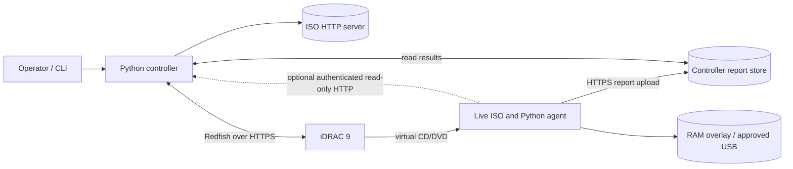

# Autonomous server health platform architecture

Status: design proposal, 2026-10-21. The local JSON/text reporting layer is now implemented; Redfish deployment and HTTP result collection are not. The existing Bash toolkit and Debian live-build definition remain the diagnostic baseline.

## Scope and boundaries

The platform has a **controller** outside the server, an **iDRAC 9** management interface, a read-only **diagnostic live ISO**, and a **report store** on the controller. The first hardware target is a Dell PowerEdge R240; other iDRAC 9 servers use capability discovery rather than a model-specific URI. The controller is the only component allowed to change one-time boot state, invoke a server reset, or eject virtual media. The live agent runs passive checks and never writes to customer data drives.



The iDRAC and the host operating system can have different network paths. iDRAC's ability to fetch the ISO does **not** prove the live host can reach the report collector. A diagnostic host NIC, address method, route, DNS, and collector reachability are preflight requirements for automatic off-box collection. A run with no host network remains at the results shell; its report stays in RAM or on an approved USB device.

## One-run sequence

1. Read `server-list.yaml`, validate a single intended target, maintenance policy, credentials reference, ISO URL, and diagnostic network profile. Never put passwords in that file.
2. Read-only Redfish discovery: service root, managers, systems, virtual-media collection, system boot capabilities, reset action, chassis, storage, and log services. Record service tag, model, iDRAC firmware, power state, and any pre-existing virtual media or boot override. Do not replace someone else's mounted media or override.
3. Build or select a validated ISO. For a production unattended run, put a short-lived, single-run enrollment credential and controller URL into a **run-specific ISO configuration**. Publish it at a per-run HTTP(S) URL reachable by iDRAC; record ISO SHA-256 and expiry. The current build script does not yet create run-specific images.
4. Insert the ISO using the discovered `VirtualMedia.InsertMedia` action. Read the virtual-media resource back and verify `Inserted` and `Image` before continuing. iDRAC 9 virtual-media resource location and identifiers vary with firmware; Dell examples show both manager-scoped and system-scoped resources. [Dell's Redfish scripting examples](https://github.com/dell/iDRAC-Redfish-Scripting/tree/master/Redfish%20Python) document these variants.
5. PATCH the system's `Boot` object with `BootSourceOverrideTarget=Cd` and `BootSourceOverrideEnabled=Once` **only when `Cd` is advertised as supported**; read back the setting. The `Once` value is intended to leave persistent boot order unchanged. Older firmware may need a Dell OEM one-time virtual-CD path, behind a tested adapter. [Dell's one-time boot examples](https://github.com/dell/iDRAC-Redfish-Scripting/blob/master/Redfish%20Python/SetNextOneTimeBootDeviceREDFISH.py) and the [Redfish boot model](https://redfish.dmtf.org/schemas/v1/DSP2046_2025.2.html) are the references.
6. Request a graceful Redfish `ComputerSystem.Reset` for a running system, or `On` if it is off. A forced reset is outside the default one-click path. Poll power and run state with bounded timeouts; a successful reset response alone is not proof of ISO boot.
7. The live ISO starts the Python agent at tty1, loads the run configuration, discovers devices, and performs every enabled passive check. It records per-check start/end times, status, data, raw evidence, unavailable reason, and provenance. A failing or unavailable check does not stop later checks.
8. The agent writes `report.json` and `report.txt` atomically to RAM-backed `/run/server-check/reports`, and optionally to an already-mounted approved `SERVER_REPORTS` USB volume. The optical ISO itself cannot be written. It may expose authenticated, read-only HTTP GET endpoints while the live system is running. Its primary delivery path is an HTTPS POST to the controller collector with the run ID and report checksum.
9. The controller validates the report schema, run credential, service tag, checksum, and run state, then persists the JSON and text report before acknowledging receipt. It combines in-band findings with read-only Redfish inventory and log evidence. Conflicting evidence stays visible with both sources and timestamps.
10. The default completion action is **leave the live system running**. If `return_to_disk` was explicitly enabled for the run, the controller may request a graceful reboot only after durable report acknowledgement. It verifies that the one-time override was consumed and that the system returned to a non-ISO boot path; it then ejects only the media it inserted. It must not eject media while the live OS still depends on it. On uncertainty, retain media/state and flag operator intervention.

## Control-plane state machine

`PLANNED -> PREFLIGHTED -> ISO_PUBLISHED -> MEDIA_INSERTED -> BOOT_ONCE_SET -> RESET_REQUESTED -> AGENT_SEEN -> RUNNING -> REPORT_STORED -> COMPLETE`

Every transition records time, request/response metadata without secrets, an idempotency key, and the discovered Redfish resource URI. Timeouts and failed transitions become `NEEDS_ATTENTION`; they never silently advance. Retrying must read current iDRAC state first. Cleanup is allowed only for the virtual-media image and boot override owned by the same run. A restart of the controller resumes from persisted state instead of remounting or rebooting blindly.

## Check ownership and report semantics

| Check | Preferred source | Cross-check or limit |
| --- | --- | --- |
| CPU and memory inventory, BIOS | Redfish System/Processors/Memory/BIOS plus live `lscpu`/`dmidecode` | Firmware may expose different fields; keep both. |
| Memory health | Redfish DIMM health, live EDAC and current-boot kernel messages | Historical corrected ECC events are evidence, not automatic DIMM failure. |
| RAID controller, virtual disk, physical disk | Redfish Storage hierarchy; live read-only vendor CLI where authorised | PERC may hide member SMART data. Never create/alter arrays. |
| SATA/SAS SMART and NVMe | Live `smartctl` and `nvme` | Mark inaccessible devices `UNAVAILABLE`; no self-tests or writes. |
| Fans, PSU, temperature | Discovered Redfish chassis sensors and live sensor/BMC reads | Use exposed status and thresholds only. |
| iDRAC/SEL/Lifecycle logs | Discovered Redfish LogServices/Entries | Filter by run window but retain historical events as historical. |
| Firmware and network adapters | Redfish inventory plus live `lspci`, `ip`, `ethtool` | Inventory is not a health pass by itself. |

Each check has `status: PASS|WARN|FAIL|UNAVAILABLE|ERROR`, `source`, `observed_at`, `summary`, `evidence`, and optional `devices`. `UNAVAILABLE` means unsupported, absent, or inaccessible; `ERROR` means a collector or tool failed. The top-level `overall_status` is `FAIL` if any health check is `FAIL`, `WARN` if any check is `WARN`, `UNAVAILABLE`, or `ERROR`, and otherwise `PASS`. A separate `completion_status: COMPLETE|PARTIAL|FAILED` describes whether the run and delivery completed. If no report arrives, the controller records an operational failure **without inventing a server health verdict**.

Illustrative minimal report:

```json
{
  "schema_version": "1.0",
  "run_id": "2026-10-21T140000Z-R240-7f3a",
  "server_serial": "EXAMPLE123",
  "overall_status": "WARN",
  "completion_status": "COMPLETE",
  "generated_at": "2026-10-21T14:12:00Z",
  "checks": [
    {"id": "memory_health", "status": "PASS", "source": "live:edac", "summary": "No current-boot uncorrected error", "evidence": []},
    {"id": "physical_disk_health", "status": "UNAVAILABLE", "source": "live:smartctl", "summary": "PERC does not expose member SMART data", "evidence": []}
  ]
}
```

Raw Redfish payloads and utility output are stored as bounded, redacted evidence artifacts linked by content hash, not silently discarded or embedded without size limits. Report names use service tag, UTC time, and run ID; missing tags use a generated identifier. JSON and human-readable text derive from the same normalized findings.

## Safety, identity, and failure behavior

- The live image retains the existing isolation policy: no automatic internal-disk mounts, LVM activation, md RAID assembly, host swap activation, or writes to customer storage. Only a verified, mounted USB volume or RAM may receive reports.
- Redfish collection is GET-only except for the narrowly scoped `InsertMedia`, one-time boot PATCH, `Reset`, and later `EjectMedia`. No firmware, BIOS setting, RAID configuration, or persistent boot-order changes are part of this workflow.
- TLS certificate verification is on by default for iDRAC and report upload. Credentials come from an environment-backed secret provider or prompt and are never stored in `server-list.yaml`, ISO URLs, logs, or reports. Bootstrap credentials in a run-specific ISO expire quickly, are scoped to one report submission, and should be treated as exposed to anyone who can fetch that ISO.
- Validate the expected service tag twice: through iDRAC before reset and inside the live agent before accepting its report. Require an exact run ID and enrollment credential to prevent cross-server association.
- The controller's report store is authoritative. RAM is volatile; an ISO is read-only. No automatic return-to-disk or media ejection occurs until controller persistence is acknowledged. If the host network is unavailable, keep the system at a shell and mark collection incomplete.
- A read-only HTTP result endpoint on the live host is optional and disabled unless the diagnostic network profile permits it. Bind to the designated diagnostic interface, require a per-run token, and limit it to health and report GETs. The controller's persisted report API is the durable HTTP interface.

## Dependencies and assumptions to validate on an R240

The selected iDRAC license and firmware must expose the required virtual-media and boot actions; the iDRAC must fetch the ISO URL; a host NIC must reach the collector if automatic retrieval is required; and the live ISO must boot in the machine's configured BIOS/UEFI mode. Dell distinguishes virtual-console media from remote file share and notes licensing and firmware differences, so discovery and a real R240 trial are release gates. [Dell virtual-media guidance](https://www.dell.com/support/kbdoc/en-ca/000185550/idrac-virtual-media-troubleshooting), [Dell iDRAC 9 feature guide](https://www.dell.com/support/manuals/en-us/idrac9-lifecycle-controller-v7.x-series/idrac9_7.xx_ug/key-features?guid=guid-790e6a21-294c-4150-9c8b-62a46d36e4b3).
